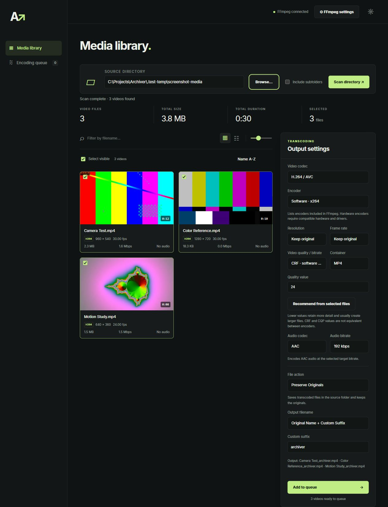
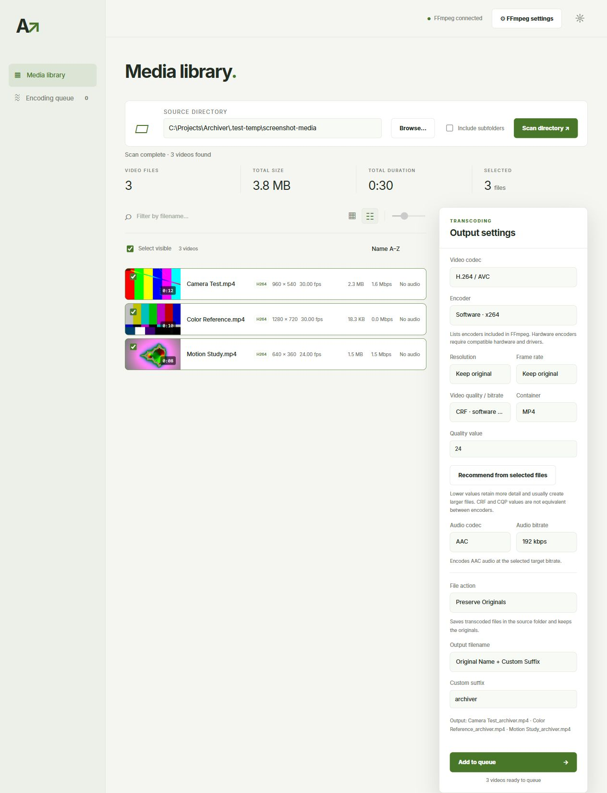
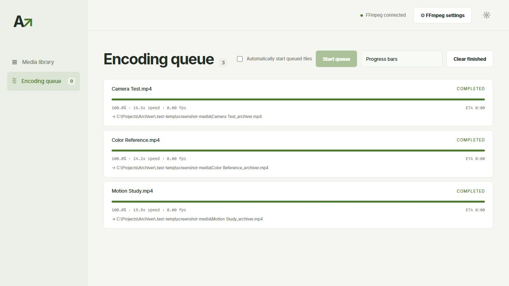
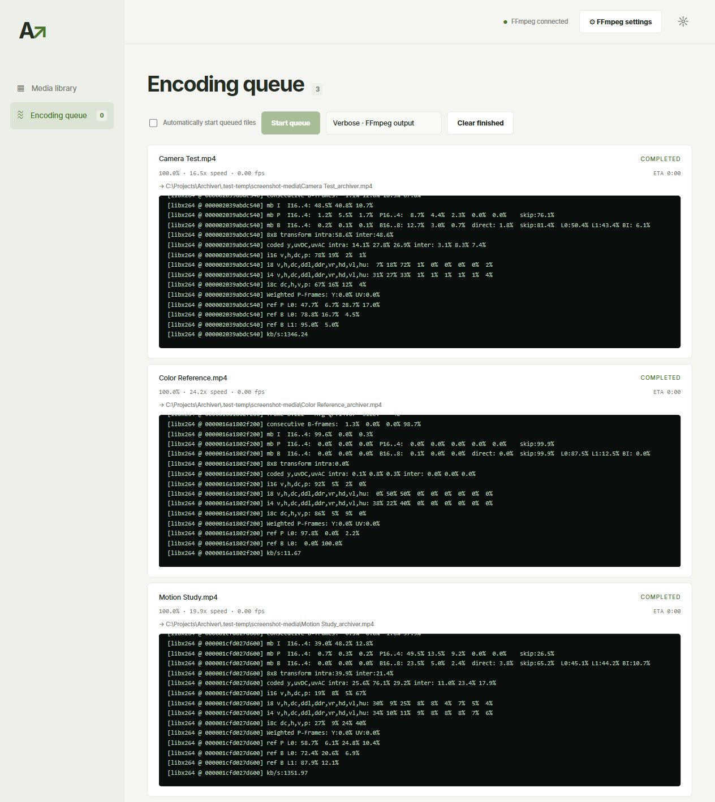

# Archiver

Archiver is simple browser-based tool that uses FFMPEG to select and transcode video files to reduce filesize.  It provides simple to use dropdowns and manual controls to tailor the output to whatever quality level you want and includes file automations for handling both the original files and output files.
## Features

- Scan folders and review file sizes, codecs, resolution, and frame rate.
- Browse resizable thumbnails with hover previews or use a detailed file list.
- Choose software or hardware encoders, including NVIDIA NVENC, Intel Quick Sync, and AMD AMF when available.
- Adjust video quality, bitrate, resolution, frame rate, and audio settings.
- Keep originals, replace them, or save transcoded files to another directory.
- Add filename suffixes or batch names and monitor jobs in a separate queue.
- Use light or dark mode.

## Screenshots

Media library with thumbnail previews, file metadata, and encoding controls. Screenshots use generated sample videos.

More views: light theme, file list, queue, and FFmpeg output

**Detailed file list and light theme**

**Encoding queue**

**Verbose FFmpeg output**

## Getting started

1. Install [Python 3.10 or newer](https://www.python.org/downloads/) and download [FFmpeg and FFprobe](https://ffmpeg.org/download.html) for your platform. They are not bundled with Archiver.
2. Download and extract the app from [Releases](https://github.com/technicallyalex/Archiver/releases).
3. Install the monitoring dependency with `python -m pip install -r requirements.txt`.
4. On Windows, double-click **Launch Archiver.bat**, or run `python app.py` from the project folder.
5. Open **FFmpeg settings** if the tools are not detected automatically.
6. Scan a folder, select videos, choose output settings, and add them to the queue. Click **Start queue** to begin.

Reducing quality, resolution, or frame rate can save space at the cost of detail or motion smoothness. Results depend on the source and encoder settings. Current output is 8-bit and does not include HDR tone mapping, so review a sample before replacing important footage.

See the [usage guide](docs/USAGE.md) for naming options, original-file handling, encoding controls, and limitations. See the [changelog](CHANGELOG.md) for release history.

## Development

System monitoring uses psutil from `requirements.txt`; GPU readings use NVIDIA’s installed `nvidia-smi` when available. Run `python -m unittest discover -s tests -v` to test and `python build_release.py` to package the app. Integration tests require FFmpeg and FFprobe; the Recycle Bin test is Windows-only. The release version is read from `VERSION`.
